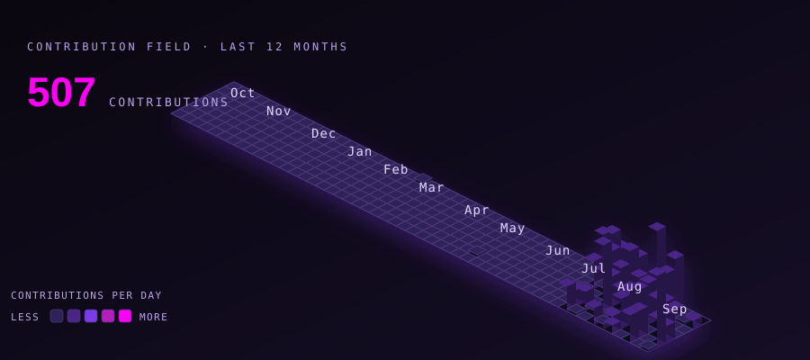
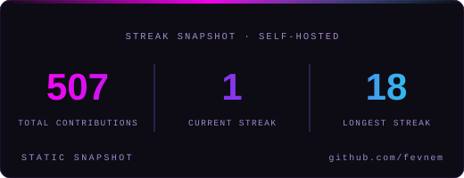
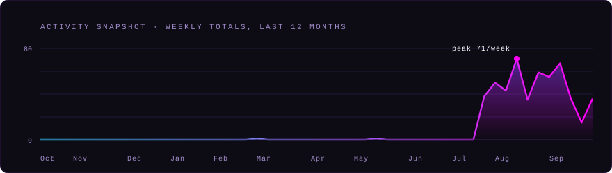

  <picture>
    <source media="(prefers-color-scheme: dark)" srcset="images/hero-3d.svg">
    <source media="(prefers-color-scheme: light)" srcset="images/hero-3d-light.svg">
    
  </picture>

    

I build automation, bots and API integrations, and I care about the unglamorous
half of it: making a workflow quietly disappear, making a service stay up, writing
the thing so it still makes sense to whoever reads it in five years.

Right now I'm going deeper into AI-driven integrations and backend systems, and I
keep gravitating to tools that are dependency-free and readable by default — no
build step, no framework, no ceremony.

**Currently:** shipping small self-contained things, usually with a game or an
experiment inside them.

  

## Stack

Lately, in roughly the order I reach for them:

          

## Selected work

| Project | What it is |
| --- | --- |
| **[unfinished-lives](https://github.com/fevnem/unfinished-lives)** | The Archive of Unfinished Lives — a bureaucratic afterlife, played one file at a time. Dependency-free, no build step, 32 branching cases. |
| **[fevnem.github.io](https://github.com/fevnem/fevnem.github.io)** | Personal site and notes. Plain HTML and CSS, deployed straight from the repo. |
| **[fevnem](https://github.com/fevnem/fevnem)** | This profile — the 3-D wireframe hero and the isometric contribution field are hand-authored SVG, no chart library and no screenshot. |

A handful of other repos here are private: client automation, bot infrastructure,
and a couple of experiments that aren't ready to be public yet.

## Activity

  <picture>
    <source media="(prefers-color-scheme: dark)" srcset="images/contrib-3d.svg">
    <source media="(prefers-color-scheme: light)" srcset="images/contrib-3d-light.svg">
    
  </picture>

  <picture>
    <source media="(prefers-color-scheme: dark)" srcset="images/card-streak.svg">
    <source media="(prefers-color-scheme: light)" srcset="images/card-streak-light.svg">
    
  </picture>

  <picture>
    <source media="(prefers-color-scheme: dark)" srcset="images/card-activity.svg">
    <source media="(prefers-color-scheme: light)" srcset="images/card-activity-light.svg">
    
  </picture>

## Elsewhere

- Writing — [fevnem.github.io](https://fevnem.github.io/)
- Posts — [@fevnem on dev.to](https://dev.to/fevnem)
- Mail — [contactsecretly@duck.com](mailto:contactsecretly@duck.com)

Best way to reach me about code is an issue on the repo in question.

Made with 💜 by <a href="https://github.com/fevnem">tri</a>

